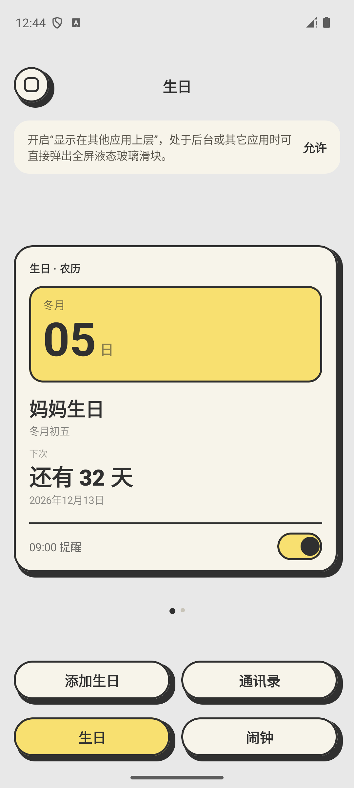
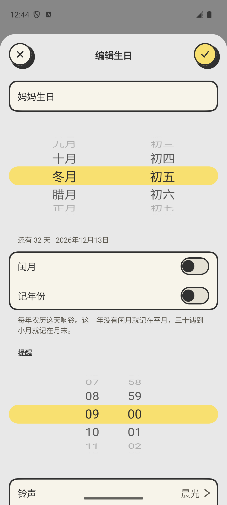
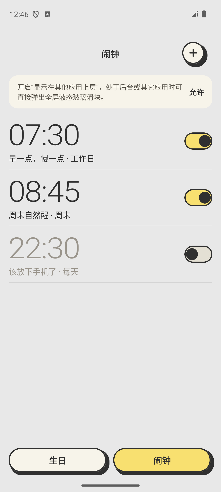
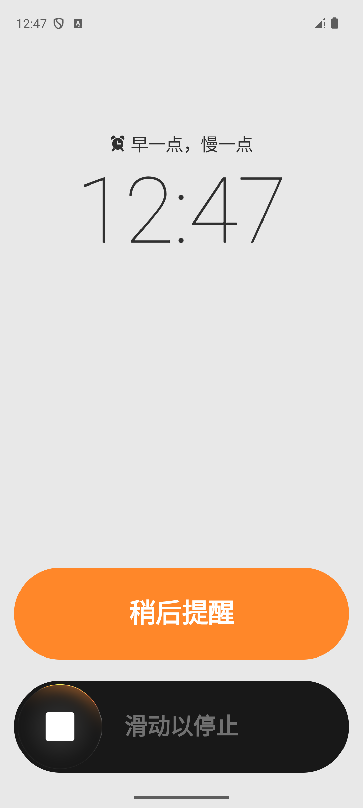

# Paper Alarm

[简体中文](README.md) · English

An Android alarm clock with a paper-inspired interface and Gregorian and Chinese lunar birthday reminders. Works offline, with no ads or account required.

[Download APK](https://github.com/ZionHeZY/paper-alarm/releases/latest) · Android 13+

## Features

- One-time and weekly alarms with a choice of sounds and adjustable snooze.
- Gregorian and Chinese lunar birthdays, with reminders recalculated each year and support for leap months.
- Read birthdays from contacts or save birthdays back to them.
- Switch between birthday cards and a list. Slide the glass control to stop an alarm.

## Screenshots

<p>
  
  
  
  
</p>

## Build

Requires JDK 17 and Android SDK 35.

```sh
./gradlew :app:assembleDebug
```

Kotlin · Jetpack Compose · AGSL

[Issues](https://github.com/ZionHeZY/paper-alarm/issues) and [pull requests](https://github.com/ZionHeZY/paper-alarm/pulls) are welcome. [MIT License](LICENSE)
