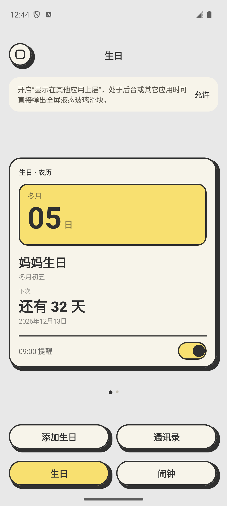
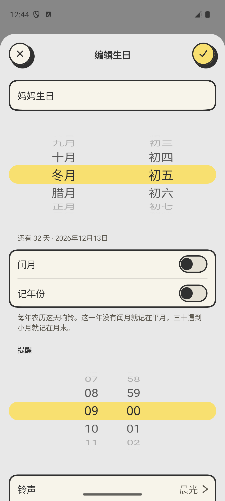
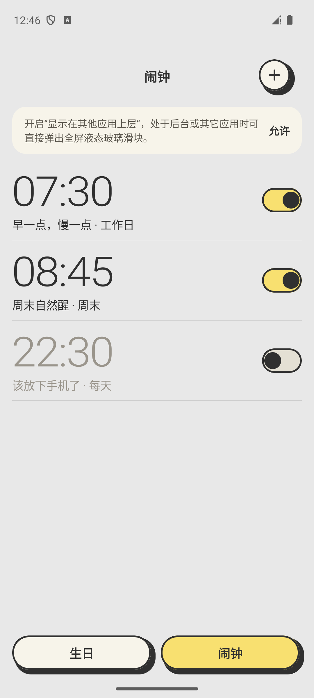
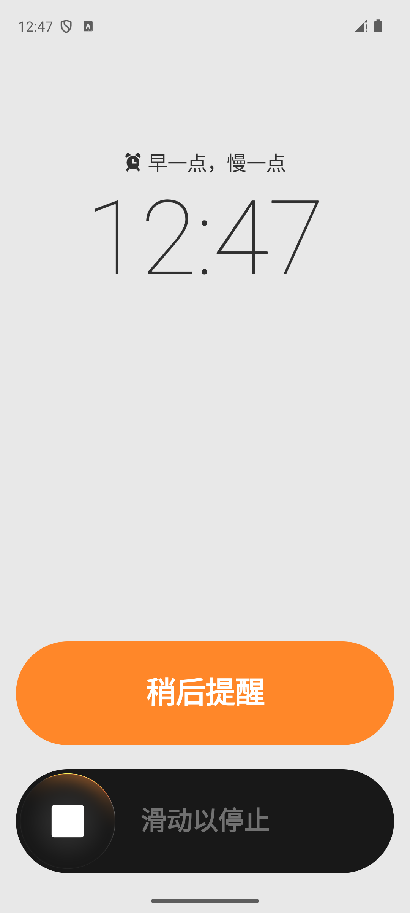

# Paper Alarm

简体中文 · [English](README.en.md)

一款纸感界面的 Android 闹钟，支持公历、农历生日提醒。离线运行，无广告，无需账户。

[下载 APK](https://github.com/ZionHeZY/paper-alarm/releases/latest) · Android 13+

## 功能

- 单次、每周重复闹钟，支持铃声选择和稍后提醒。
- 公历与农历生日，每年重新计算提醒日期，支持闰月。
- 从通讯录读取生日，也可将生日写回联系人。
- 生日卡片与列表切换，玻璃滑块停止响铃。

## 截图

<p>
  
  
  
  
</p>

## 构建

JDK 17、Android SDK 35。

```sh
./gradlew :app:assembleDebug
```

Kotlin · Jetpack Compose · AGSL

欢迎提交 [Issue](https://github.com/ZionHeZY/paper-alarm/issues) 和 [PR](https://github.com/ZionHeZY/paper-alarm/pulls)。[MIT License](LICENSE)
